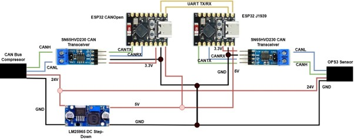
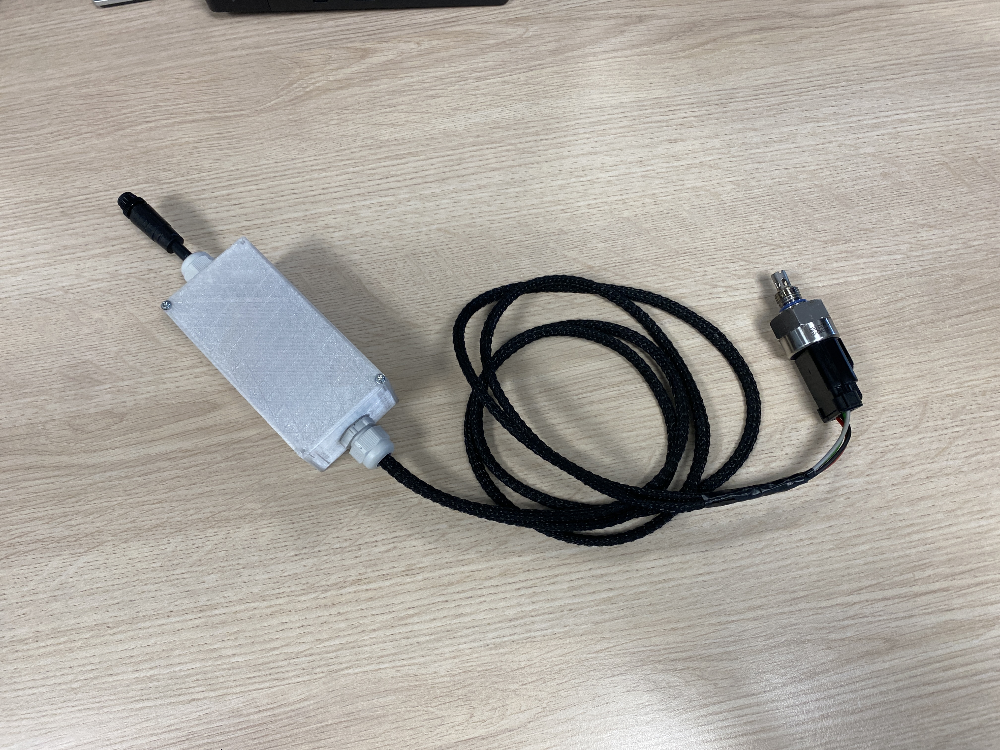

# J1939 to CANopen Gateway

A low-cost gateway that converts sensor data from a J1939 network into CANopen process data.

The original purpose of this project was to integrate automotive J1939 sensors into a laboratory CANopen environment without requiring expensive commercial gateway hardware. The current implementation targets the **TE Connectivity OPS3 Oil Property Sensor**, but it can be adapted to support other J1939 devices.

The gateway is built using two **ESP32-C3 Mini** development boards, each equipped with its own CAN transceiver. The devices communicate via UART, resulting in the following unidirectional data flow:

```text
J1939 Sensor
     │
     ▼
 ESP32 #1
     │ UART
     ▼
 ESP32 #2
     │
     ▼
 CANopen Network
```

---

## Features

### J1939 Side

- Supports the TE Connectivity OPS3 Oil Property Sensor
- J1939 communication at **250 kbit/s**
- Easily extendable to additional J1939 sensors

### CANopen Side

The CANopen stack is intentionally lightweight and only implements the features required for this project.

Implemented services:

- NMT Slave
- Node Guarding
- SDO Server
- TPDO Transmission on SYNC
- LSS Protocol (CiA 305)
- TPDO Mapping according to CiA 404 (Analog Input Device Profile)

The CANopen interface operates at **125 kbit/s**.

---

## Limitations

### J1939

The current implementation is tailored to the TE Connectivity OPS3 sensor. Other sensors can be supported by extending the J1939 message parser.

### CANopen

This is **not a complete CANopen implementation**.

Only the functionality required for the gateway application has been implemented. Additional objects can be added to the object dictionary if needed.

The object dictionary uses a custom hash table implementation. While hash collisions are theoretically possible, no issues have been observed with the set of objects used in this project.

For production-grade CANopen applications, consider using the excellent [CANopenNode](https://github.com/CANopenNode/CANopenNode) project instead.

---

## Architecture

Two ESP32-C3 Mini boards are connected via UART.

### ESP32 #1 – J1939 Interface

- Receives J1939 frames from the OPS3 sensor
- Parses relevant sensor data
- Transfers the processed data via UART

### ESP32 #2 – CANopen Interface

- Receives sensor values from the UART connection
- Implements the CANopen application layer
- Publishes the sensor data through CANopen TPDOs

---

## Prototype

The prototype hardware is wired as shown below.

<p align="center">
  
</p>

The assembled gateway is housed in a custom 3D-printed enclosure.

<p align="center">
  
</p>

---

## Hardware

The prototype was built using:

- 2 × ESP32-C3 Mini development boards
- 2 × CAN transceivers
- TE Connectivity OPS3 Oil Property Sensor
- 3D-printed enclosure
- UART connection between the ESP32 devices

---

## Dependencies

- [ESP-IDF](https://docs.espressif.com/projects/esp-idf/en/stable/esp32/get-started/index.html)
- Visual Studio Code (recommended)
- ESP32-C3 development boards
- CAN transceivers compatible with the ESP32-C3

---

## Building and Flashing

1. Install the ESP-IDF toolchain.
2. Open the project in Visual Studio Code with the ESP-IDF extension.
3. Configure the target device.
4. Build the project:

```bash
idf.py build
```

5. Flash the firmware:

```bash
idf.py -p <PORT> flash
```

6. Monitor the serial output:

```bash
idf.py monitor
```

---

## Version History

### v1.0.2

- Initial working release
- Basic J1939-to-CANopen gateway functionality
- Single TPDO configuration
- TPDO transmitted on every SYNC message regardless of configuration

---

## Motivation

This project was implemented from scratch primarily for educational purposes and to gain a deeper understanding of both J1939 and CANopen protocols.

While the implementation is suitable as a reference, learning project, or test setup, it is not intended to replace mature CANopen stacks in production environments.

---

## License

This project is licensed under the MIT License. See the `LICENSE` file for details.

---

## Acknowledgments

- [CANopenNode](https://github.com/CANopenNode/CANopenNode) for serving as an excellent CANopen reference implementation and learning resource.
